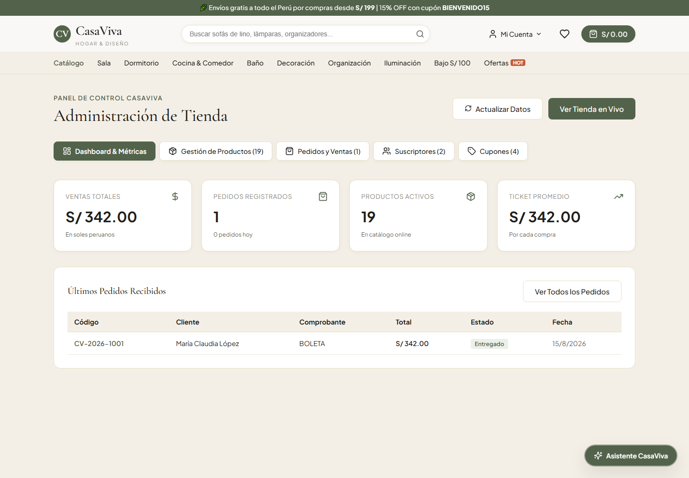

# CasaViva | Home Goods E-commerce

[Español](#espanol) · [English](#english)

[Demo](https://casaviva-puce.vercel.app) · [GitHub](https://github.com/Jp3528/CasaViva)



<a id="espanol"></a>

## Español

### Descripción

Aplicación web de comercio electrónico para productos de hogar. Integra una tienda en React con una API Express organizada en controladores, servicios y repositorios, y permite explorar el flujo de compra con datos de demostración o PostgreSQL.

### Funcionalidades

- Catálogo con categorías, variantes de producto y reseñas.
- Carrito, cupones y checkout por pasos con creación de pedidos.
- Registro, autenticación y perfil de cliente.
- Vistas administrativas de productos, pedidos y ventas.
- Asistente de consultas sobre la tienda.

### Tecnologías

React 18 · TypeScript · Vite · Node.js · Express · PostgreSQL · Vitest

### Ejecutar localmente

**Requisitos:** Node.js 22 y npm; PostgreSQL si deseas persistencia entre reinicios.

```bash
git clone https://github.com/Jp3528/CasaViva.git
cd CasaViva
```

```bash
npm ci
```

**Configuración.** La demo usa datos en memoria cuando PostgreSQL no está disponible. Para conectarlo, crea `server/.env` a partir de [`server/.env.example`](server/.env.example) y configura `DATABASE_URL`, `PORT` y un `JWT_SECRET` privado. La API carga dotenv desde el directorio `server`.

```bash
npm run dev
```

Tienda: `http://localhost:5173`. API: `http://localhost:4000`. Salud: `http://localhost:4000/api/health`. Las cuentas semilla incluyen `admin@casaviva.pe` / `Admin2026*CV` y `maria.lopez@ejemplo.com` / `Cliente123*`; son exclusivamente de demostración.

### Comprobaciones

```bash
npm run typecheck
npm test
npm run build
```

Comandos disponibles para comprobar el proyecto en un entorno con sus dependencias instaladas.

### Estructura

| Ruta                                                                       | Contenido                                         |
| -------------------------------------------------------------------------- | ------------------------------------------------- |
| [`client/`](client/)                                                       | Interfaz, páginas, componentes y contextos React. |
| [`server/src/`](server/src/)                                               | API, lógica de negocio y acceso a datos.          |
| [`server/src/repositories/schema.sql`](server/src/repositories/schema.sql) | Esquema de PostgreSQL.                            |
| [`api/`](api/)                                                             | Entradas de API para Vercel.                      |

### Alcance

Proyecto de portafolio con pagos simulados. El modo en memoria pierde cambios al reiniciar y no sustituye una base persistente. El despliegue de Vercel está definido en `vercel.json`; para uso público con datos reales se deben configurar persistencia, secretos y permisos administrativos.

---

<a id="english"></a>

## English

### Overview

A home goods e-commerce application combining a React storefront with an Express API organized into controllers, services and repositories. The shopping flow can be explored with demo data or PostgreSQL.

### Features

- Catalog with categories, product variants and reviews.
- Cart, coupons and step-by-step checkout with order creation.
- Registration, authentication and customer profiles.
- Administrative views for products, orders and sales.
- A store information assistant.

### Technology

React 18 · TypeScript · Vite · Node.js · Express · PostgreSQL · Vitest

### Run locally

**Requirements:** Node.js 22 and npm; PostgreSQL if you need data to persist across restarts.

```bash
git clone https://github.com/Jp3528/CasaViva.git
cd CasaViva
```

```bash
npm ci
```

**Configuration.** The demo uses in-memory data when PostgreSQL is unavailable. To connect a database, create `server/.env` from [`server/.env.example`](server/.env.example) and set `DATABASE_URL`, `PORT` and a private `JWT_SECRET`. The API loads dotenv from the `server` directory.

```bash
npm run dev
```

Storefront: `http://localhost:5173`. API: `http://localhost:4000`. Health: `http://localhost:4000/api/health`. Seed accounts include `admin@casaviva.pe` / `Admin2026*CV` and `maria.lopez@ejemplo.com` / `Cliente123*`; these are demo credentials only.

### Checks

```bash
npm run typecheck
npm test
npm run build
```

Available commands for checking the project in an environment with its dependencies installed.

### Structure

| Path                                                                       | Contents                                  |
| -------------------------------------------------------------------------- | ----------------------------------------- |
| [`client/`](client/)                                                       | React UI, pages, components and contexts. |
| [`server/src/`](server/src/)                                               | API, business logic and data access.      |
| [`server/src/repositories/schema.sql`](server/src/repositories/schema.sql) | PostgreSQL schema.                        |
| [`api/`](api/)                                                             | API entry points for Vercel.              |

### Scope

A portfolio project with simulated payments. In-memory mode loses changes on restart and does not replace persistent storage. Vercel deployment is defined in `vercel.json`; public use with real data requires persistent storage, private secrets and administrative access controls.
